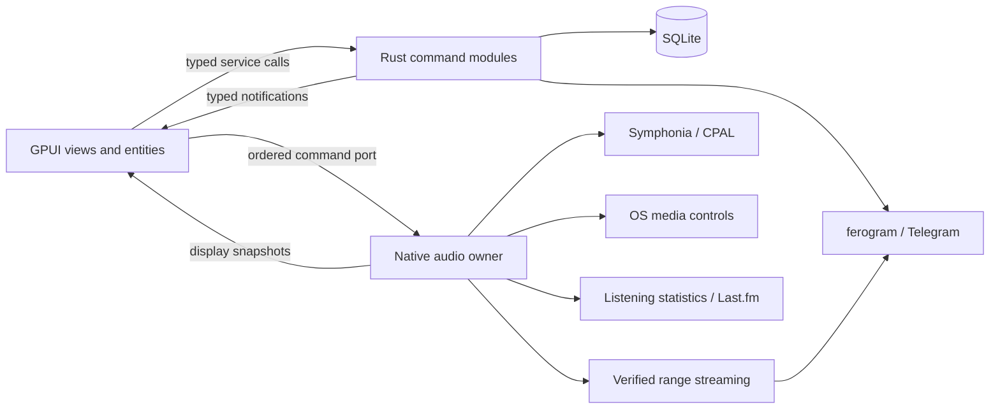

# Architecture

SoundGrammy is a local-first native GPUI application. Rust owns Telegram MTProto, SQLite, streaming, decoding, playback, queue policy and listening accounting. GPUI renders the interface on desktop and Android. Cargo manages development, checks and dependencies; the Rust `xtask` package handles packaging, Android builds and maintenance.

## Runtime and identity

`native/src/runtime.rs` owns the Tokio executor, application resources, an exhaustive domain event enum and native paths. `AppHost` contains weak references so background jobs cannot retain a closed desktop application. Event variants carry their concrete payload types; there are no string names or payload downcasts. GPUI drains notifications on its app thread; native media adapters dispatch their main-thread work through that channel.

`native-app.json` supplies the release identifier `com.soundgrammy.app`, product name, version and initial window dimensions. Debug builds overlay `native-app.dev.json`, retaining the isolated `com.soundgrammy.app.dev` identity. Packaging and runtime read these same configurations. The existing database, cache, `session.enc`, Telegram keyring and Last.fm service names are retained.

On Android a process-level resource owner survives Activity recreation. A new GPUI view attaches its notification receiver and requests an authoritative audio snapshot. Playback remains owned by the Rust core and existing foreground service. Closing a view does not close an active stream. Explicit task removal stops playback and the process through the existing service policy.

`--preview` uses deterministic sample metadata and temporary directories, starts no Telegram/audio services and never reads a production account. It exists for screenshots and native UI regression tests.

## Authentication and bootstrap

Local authentication verifies the encrypted session and SQLite profile before network access. An offline library becomes usable without waiting for Telegram. Login supports QR, phone code and two-factor password flows. Password input is cleared after submission. QR start, poll and restart remain separate service calls.

Library hydration reads bounded pages with a revision and retries if a concurrent sync invalidates the snapshot. Playlist, cache and statistics reads are independent of successfully loaded tracks. Failed optional reads retain their last known values, show a recoverable error and can be retried without hiding the library. Background reconnection uses bounded backoff and soft-syncs after reconnecting. Confirmed full reindex persists its blocking intent before network work, preserving resume behavior across restarts.

Every UI task captures a view/account epoch. Logout/revocation advances it and clears account presentation state; old results cannot repopulate the library. Mutations additionally check the database account generation before dispatch. Library batches check account IDs and revisions. Progress notifications update only jobs owned by the current view.

## Presentation

`native/src/ui/mod.rs` initializes GPUI, menus and shortcuts. `app.rs` composes the
window's retained feature entities and coordinates shared navigation/account intent.
The UI is organized by feature:

| Module | Owns |
|---|---|
| `login.rs`, `account.rs` | A retained sign-in view with native inputs, QR/focus state; authentication and reconnect orchestration |
| `library/model.rs` | Observable library state, cached projections, sorting and positional selection |
| `library/{view,sidebar,row,actions}.rs` | Library layout, navigation, row interactions and playlist operations |
| `player/` | An observable sanitized playback snapshot, transport intent, controls and queue presentation |
| `settings.rs` | A retained settings model with its native form inputs and disclosure state; settings workflows |
| `panels.rs`, `dialogs.rs`, `overlays.rs` | Panel navigation, focus restoration and dialog/overlay composition |
| `fullscreen.rs`, `artwork.rs`, `motion.rs` | Fullscreen behavior, image preparation and isolated animation/render layers |
| `startup.rs`, `tasks.rs`, `events.rs`, `effects.rs` | Worker startup, guarded async results, typed event routing and model-driven preparation |
| `theme.rs` | Shared semantic design tokens for both Kit's theme and custom surfaces |

The native audio owner remains authoritative. `transport.rs` serializes commands so
a slow load cannot be overtaken by a later pause/seek/volume request. A separate
view-lifetime token invalidates queued UI intent on logout, alongside database
generation checks and the epoch guard on result application.

Cached feature layers observe their own library/playback model and receive explicit
presentation inputs for shared UI state. They no longer subscribe to every shell
notification. Playback progress can update the seek rail without rerendering
unrelated track rows; visible list containers still coordinate virtual scrolling.

`startup.rs` opens storage, upgrades schemas and imports preferences on a blocking
worker before attaching platform services on GPUI's thread. `effects.rs` prepares
artwork, loading timers and native fullscreen transitions after intent/results,
rather than starting those operations from the root render method. Native input
focus, slider values and transient layout state are reconciled by their views.

Kit supplies the sidebar resize lifecycle, settings accordion structure, radio
semantics, dialogs, popovers, native menus, sliders and inputs. Custom visuals use
Kit's unstyled primitives where needed. Kit handles keyboard focus for playlist
tabs. The app selects the corresponding panel as focus moves between tabs.

GPUI entities are observable Rust state. A render method builds a flex layout and components using chained `.child(...)` calls, roughly the role JSX and component state served previously. GPUI has its own input/focus/event system and GPU drawing; there is no DOM, CSS engine or JavaScript bridge.

Track lists and queue rows are virtualized. Search and multi-column sorting retain each track's original membership position, including duplicate tracks and gaps in metadata. Range selection follows displayed order. Positional edits include the expected ordered membership and queue revisions. Native context/dropdown menus, focus traps and keyboard bindings replace browser widgets. Nested dialogs retain their parent on Back/Escape.

`ui/preferences.rs` imports known UI settings once from previous WebKit/Chromium storage. It opens SQLite read-only and performs LevelDB recovery only on a temporary copy. Preferences and opt-in bounded diagnostics subsequently live in app settings. A single background settings writer coalesces pending values per key over a bounded 150 ms interval, serializes them away from GPUI and flushes the final values during orderly shutdown. UI callbacks do not wait for SQLite or log-history writes. Fullscreen artwork retains palette extraction, reduced-motion handling, dynamics/beat balance, attack/release smoothing and profile crossfade. Display-wake requests are serialized independently of playback.

## Domain ownership

| Domain | Owner |
|---|---|
| Library and account revisions | `native/src/db/library.rs`, `telegram/saved_music.rs` |
| Playlist writes and duplicate membership | `native/src/db/playlists.rs`, `commands/playlists.rs` |
| Queue, repeat and smart shuffle | `native/src/audio/session.rs`, `audio/shuffle.rs` |
| Playback, buffering and seeks | `native/src/audio/mod.rs`, `audio/source/`, `audio/availability.rs` |
| Verified downloads and cancellation | `native/src/streaming*`, `telegram/download.rs` |
| Cache, artwork and eviction | `native/src/cache*` |
| Downloads and JSON recipes | `native/src/export.rs`, `playlist_recipe.rs` |
| Listening and scrobbling | `native/src/listen_stats.rs`, `audio/activity.rs`, `lastfm/` |
| Credentials and encrypted sessions | `native/src/session.rs`, `config.rs`, `android_keyring.rs` |
| OS media controls | `native/src/audio/media/` |
| Android foreground/lifecycle behavior | `native/gen/android/.../PlaybackService.kt`, `NativeMediaSession.kt` |

The native session is authoritative for the queue and transport. UI snapshots use `Snapshot::for_display()`, stripping Telegram document descriptors from queue and shuffle base entries. Playback resolves metadata from SQLite again before accepting membership intent. Audio bytes never pass through presentation entities.

Local library/playlists/settings/cache survive app restarts. The in-memory playback queue survives Android view recreation and backgrounding, but is not persisted through process death. Last.fm pending scrobbles and local listening aggregates retain their existing SQLite persistence.

## Validation

The existing Rust domain suite remains in place. New tests cover presentation policy, preference migration, ordered transport, sanitization and production GPUI views at desktop/compact sizes. Android retains JVM and instrumented lifecycle tests, with additional host input inheritance coverage. [Test migration inventory](gpui-test-migration.md) maps the former frontend suites to native ownership. [Migration evidence](gpui-migration.md) records completed checks and platform acceptance still requiring hardware.

On macOS, the upstream GPUI window backend uses a Metal display link and pauses
it when there is no frame demand. Drawers and dialogs use a dim backdrop on
all platforms, with a solid, shadowed navigation drawer. Fullscreen artwork
uses cached image layers prepared on the blocking executor.

See [dependency maintenance](dependencies.md) for the pinned compiler/framework pair, local patch removal criteria and platform validation procedure.
