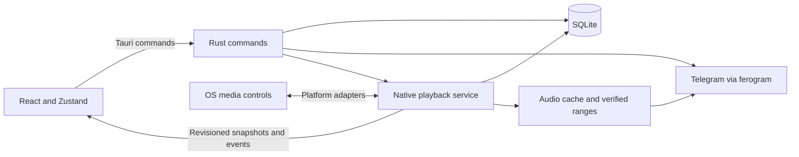

# Architecture

SoundGrammy is a local-first Tauri music player for Telegram profile music. React sends commands through `src/lib/api.ts` and observes Tauri events. Rust owns Telegram access, SQLite, playback, and listening history. See the [README](../README.md#supported-platforms) for supported platforms.

## Startup and sync

- `auth_status` uses local session state and the SQLite profile. It makes no Telegram request. Once authorized, `useAppSession` loads display metadata and playlists. Statistics and cache status load independently, so failures there leave the library usable.
- The frontend loads the complete local display index in revision-checked pages. The virtual viewport only limits rendering. Search, selection, playlist resolution, and queue construction use the whole index.
- Automatic reconnect and manual refresh share the connectivity store and use soft sync. Network failures preserve the local library and session. Server-confirmed revocation clears the session and emits `auth:revoked`. Logout and account changes invalidate in-flight account-scoped work.
- The Telegram client connects on demand. A failed connection through a configured MTProto proxy leaves Telegram offline and records the connection error. If applying changed proxy settings fails, the app restores the previous settings for the next reconnect attempt.

### Library indexing

Both sync modes check Telegram's ordered saved-music ID manifest. The manifest and metadata completeness are stored independently. An unchanged manifest can skip metadata requests only for a complete index.

- **Soft sync** keeps the local library visible, fetches metadata for missing IDs, and publishes committed additions through revisioned `library:batch` events. Existing metadata and relative order are preserved. Manifest ordinals guide page selection, and a later retry recomputes missing IDs from committed data.
- **Initial and full indexing** hide the library until indexing and final local hydration complete. Confirmed full reindex persists that intent before the first network request, even if the app is offline. Existing rows remain in storage, and retained documents keep their local IDs, playlist memberships, and statistics. Each page and its cursor commit together. A retry validates an overlapping page before resuming.
- Pruning requires a final manifest check and exact membership validation. Failed scans retain committed progress. The UI reloads its snapshot after changes or possible partial commits to repair missed events. Long Telegram flood waits persist an account-specific retry deadline across restarts.

## Data ownership

| Data | Owner and storage |
| --- | --- |
| Telegram profile music | Telegram owns membership. SQLite stores the local display catalogue and sync checkpoints. |
| Liked and custom playlists | SQLite owns membership and order. |
| Playback queue, cursor, and position | Rust owns the in-memory session. Zustand mirrors revisioned snapshots. |
| Repeat and shuffle | The Rust session applies preferences saved in SQLite. |
| App volume | The UI saves volume in localStorage and applies it to native output. |
| Listening history and pending Last.fm scrobbles | SQLite stores events, aggregates, and queued scrobbles. The OS credential store holds the Last.fm session key. |
| Audio cache | Rust manages complete files and verified partial downloads under the app cache directory. |

## Playlists and exports

- **All tracks** follows the indexed Telegram order. **Popular** and **Recent** are read-only views derived from listening statistics and the current library.
- **Liked** has unique membership managed through `toggle_like`. **Custom playlists** support repeated track IDs as distinct ordered entries. Both support reordering. Drag reorder is available when search, column sorting, and selection mode are clear.
- The playlist store serializes mutations within an account lifetime. Position-based actions carry the viewed membership or revision so a concurrent change cannot silently retarget another row. Backend playlist and library commits reconcile the native queue before acknowledgment.
- **Playlist JSON** carries ordered Telegram document IDs for same-account transfer. Import previews matches and creates a new custom playlist.
- **Cache** stores app-managed audio. **Download** exports files to Downloads, where they survive cache eviction. Playlist download adds a relative-path `.m3u8` for successfully exported tracks and reports file failures or playlist-write warnings separately.

## Where to change what

| Concern | Start here |
| --- | --- |
| Tauri commands and events | [Registration](../src-tauri/src/lib.rs), [Rust commands](../src-tauri/src/commands.rs), [frontend API](../src/lib/api.ts) |
| Startup and library hydration | [Session hook](../src/hooks/use-app-session.ts), [hydration](../src/lib/library-hydration.ts), [connectivity store](../src/stores/connectivity-store.ts) |
| Saved-music sync | [Telegram sync](../src-tauri/src/telegram/saved_music.rs), [SQLite library](../src-tauri/src/db/library.rs) |
| Playlist actions and persistence | [Frontend action rules](../src/lib/playlist-track-actions.ts), [playlist store](../src/stores/playlists-store.ts), [SQLite playlists](../src-tauri/src/db/playlists.rs) |
| Session and credentials | [Security](security.md) |
| Playback, buffering, and OS controls | [Native audio](native-audio.md), [streaming](streaming.md), [platform playback](platform-playback.md) |
| Listening history | [Listening statistics](listen-statistics.md) |
| Releases | [Release guide](releasing.md) |

## Fullscreen visuals

With dynamic visuals enabled, Rust analyzes a complete cached track into a versioned profile stored in SQLite. The UI samples it at playback time. Ambient artwork colors can display while the profile is pending, and reduced motion disables animation. See the [audio analyzer](../src-tauri/src/bounce_analysis.rs), [animation hook](../src/hooks/use-artwork-bounce.ts), and [palette extraction](../src/hooks/use-image-palette.ts).
