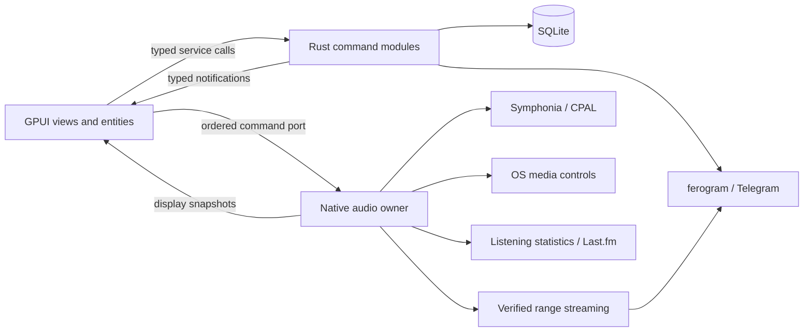

# Architecture

SoundGrammy is a local-first native GPUI application. Rust owns Telegram MTProto, SQLite, streaming, decoding, playback, queue policy and listening accounting. GPUI renders the interface on desktop and Android. Cargo manages development, checks and dependencies; the Rust `xtask` package handles packaging, Android builds and maintenance.

## Runtime and identity

`native/src/runtime.rs` owns the Tokio executor, application resources, typed notifications and native paths. `AppHost` contains weak references so background jobs cannot retain a closed desktop application. GPUI drains notifications on its app thread; native media adapters dispatch their main-thread work through that channel.

`native-app.json` supplies the release identifier `com.soundgrammy.app`, product name, version and initial window dimensions. Debug builds overlay `native-app.dev.json`, retaining the isolated `com.soundgrammy.app.dev` identity. Packaging and runtime read these same configurations. The existing database, cache, `session.enc`, Telegram keyring and Last.fm service names are retained.

On Android a process-level resource owner survives Activity recreation. A new GPUI view attaches its notification receiver and requests an authoritative audio snapshot. Playback remains owned by the Rust core and existing foreground service. Closing a view does not close an active stream. Explicit task removal stops playback and the process through the existing service policy.

`--preview` uses deterministic sample metadata and temporary directories, starts no Telegram/audio services and never reads a production account. It exists for screenshots and native UI regression tests.

## Authentication and bootstrap

Local authentication verifies the encrypted session and SQLite profile before network access. An offline library becomes usable without waiting for Telegram. Login supports QR, phone code and two-factor password flows. Password input is cleared after submission. QR start, poll and restart remain separate service calls.

Library hydration reads bounded pages with a revision and retries if a concurrent sync invalidates the snapshot. Optional cache/statistics data cannot prevent the library from becoming usable. Background reconnection uses bounded backoff and soft-syncs after reconnecting. Confirmed full reindex persists its blocking intent before network work, preserving resume behavior across restarts.

Every UI task captures a view/account epoch. Logout/revocation advances it and clears account presentation state; old results cannot repopulate the library. Mutations additionally check the database account generation before dispatch. Library batches check account IDs and revisions. Progress notifications update only jobs owned by the current view.

## Presentation

`native/src/ui/mod.rs` coordinates service calls, authentication, snapshots and account lifetime. `views.rs` contains the native views; `actions.rs` handles user operations. `model.rs` implements playlist identity, sorting, search, positional selection, duplicate occurrence mapping, queue sections and settings policy. `transport.rs` serializes player commands so a slow load cannot be overtaken by a later pause/seek/volume request.

GPUI entities are observable Rust state. A render method builds a flex layout and components using chained `.child(...)` calls, roughly the role JSX and component state served previously. GPUI has its own input/focus/event system and GPU drawing; there is no DOM, CSS engine or JavaScript bridge.

Track lists and queue rows are virtualized. Search and multi-column sorting retain each track's original membership position, including duplicate tracks and gaps in metadata. Range selection follows displayed order. Positional edits include the expected ordered membership and queue revisions. Native context/dropdown menus, focus traps and keyboard bindings replace browser widgets. Nested dialogs retain their parent on Back/Escape.

`ui/preferences.rs` imports known UI settings once from previous WebKit/Chromium storage. It opens SQLite read-only and performs LevelDB recovery only on a temporary copy. Preferences and opt-in bounded diagnostics subsequently live in app settings. Fullscreen artwork retains palette extraction, reduced-motion handling, dynamics/beat balance, attack/release smoothing and profile crossfade. Display-wake requests are serialized independently of playback.

## Domain ownership

| Domain | Owner |
|---|---|
| Library and account revisions | `native/src/db/library.rs`, `telegram/saved_music.rs` |
| Playlist writes and duplicate membership | `native/src/db/playlists.rs`, `commands/playlists.rs` |
| Queue, repeat and smart shuffle | `native/src/audio/session.rs`, `audio/shuffle.rs` |
| Playback, buffering and seeks | `native/src/audio/mod.rs`, `audio/source/`, `audio/availability.rs` |
| Verified downloads and cancellation | `native/src/streaming*`, `telegram/download.rs` |
| Cache, artwork and eviction | `native/src/cache*` |
| Downloads and JSON recipes | `native/src/export.rs`, `playlist_recipe.rs` |
| Listening and scrobbling | `native/src/listen_stats.rs`, `audio/activity.rs`, `lastfm/` |
| Credentials and encrypted sessions | `native/src/session.rs`, `config.rs`, `android_keyring.rs` |
| OS media controls | `native/src/audio/media/` |
| Android foreground/lifecycle behavior | `native/gen/android/.../PlaybackService.kt`, `NativeMediaSession.kt` |

The native session is authoritative for the queue and transport. UI snapshots use `Snapshot::for_display()`, stripping Telegram document descriptors from queue and shuffle base entries. Playback resolves metadata from SQLite again before accepting membership intent. Audio bytes never pass through presentation entities.

Local library/playlists/settings/cache survive app restarts. The in-memory playback queue survives Android view recreation and backgrounding, but is not persisted through process death. Last.fm pending scrobbles and local listening aggregates retain their existing SQLite persistence.

## Validation

The existing Rust domain suite remains in place. New tests cover presentation policy, preference migration, ordered transport, sanitization and production GPUI views at desktop/compact sizes. Android retains JVM and instrumented lifecycle tests, with additional host input inheritance coverage. [Test migration inventory](gpui-test-migration.md) maps the former frontend suites to native ownership. [Migration evidence](gpui-migration.md) records completed checks and platform acceptance still requiring hardware.

The macOS GPUI backend is pinned and patched locally under `native/vendor/gpui-pre-macos`. It uses the window's modern display link for high-refresh rendering and connects GPUI frame demand to clock suspension while idle. See that directory's `SOUNDGRAMMY-PATCH.md` for lifecycle/fallback details. On macOS, the `gpui-pre-apple` patch composites backdrop blur and fullscreen colour blending on the GPU. Modal surfaces do not read and CPU-blur the framebuffer on the UI thread. Other platforms retain their existing rendering fallback.
